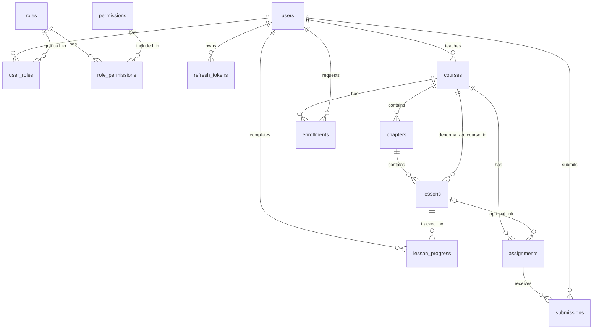

# Mô hình dữ liệu (ERD) mức tổng quan

> Phiên bản: 0.2 (Draft) | Ngày: 09/10/2026
> Chỉ liệt kê cột quan trọng và ràng buộc cốt lõi. Danh sách cột đầy đủ và kiểu dữ liệu chính xác của từng bảng nằm trong **spec module** (giai đoạn 5).
> Các bảng auth (`users`, `roles`, `permissions`, `user_roles`, `role_permissions`, `refresh_tokens`) đã chi tiết ở `auth-spec.md`; ở đây chỉ nhắc để thấy quan hệ.

---

## 1. Quy ước chung

| Hạng mục | Quy ước |
|---|---|
| Tên bảng, cột | `snake_case`, bảng dạng số nhiều (`courses`); trong code/API dùng `camelCase` |
| Khoá chính | `BIGINT IDENTITY` cho bảng nghiệp vụ (users, courses, ...); `INT IDENTITY` cho bảng danh mục (roles, permissions); bảng nối dùng khoá chính phức hợp |
| Thời gian | `DATETIME2`, **lưu UTC**; cột `created_at`, `updated_at` ở mọi bảng nghiệp vụ |
| Ngày thuần | `DATE` (ngày bắt đầu/kết thúc khoá) |
| Trạng thái | `VARCHAR` + `CHECK (... IN (...))`, không dùng enum của DB, để thêm giá trị mới chỉ cần migration nhỏ |
| Khoá ngoại | Có ràng buộc FK ở DB; **mặc định `NO ACTION`**, chỉ `CASCADE` ở bảng con thuần tuý (`user_roles`, `role_permissions`, `refresh_tokens`) |
| Xoá dữ liệu | Không xoá thật `users`, `courses`; đối tượng đã có dữ liệu phụ thuộc thì chặn xoá (xem mục 7) |
| Chuỗi tiếng Việt | `NVARCHAR` |
| Collation | Database tạo với `Vietnamese_100_CI_AI` (không phân biệt hoa/thường và dấu) để tìm kiếm tiếng Việt gõ không dấu. Lưu ý: `tempdb` dùng collation mặc định của server, nên truy vấn nối bảng tạm với bảng nghiệp vụ phải chỉ rõ `COLLATE` |

## 2. Sơ đồ quan hệ



Quan hệ nhiều-nhiều và bảng nối:

| Quan hệ | Bảng nối | Thuộc tính riêng |
|---|---|---|
| user ↔ role | `user_roles` | |
| role ↔ permission | `role_permissions` | |
| user (học viên) ↔ course | `enrollments` | `status`, `requested_at`, `decided_at`, `decided_by` |
| user (học viên) ↔ lesson | `lesson_progress` | `completed_at` |
| user (học viên) ↔ assignment | `submissions` | liên kết, ghi chú, thời điểm nộp, **điểm, nhận xét** |

> Điểm và nhận xét nằm ngay trong `submissions` vì Phase 1 mỗi bài nộp chỉ có một lần chấm (quan hệ 1-1). Nếu sau này cần lịch sử chấm, tách bảng `gradings`.

## 3. Bảng nghiệp vụ (cột chính)

```
courses
  id              BIGINT IDENTITY PK
  instructor_id   BIGINT NOT NULL FK -> users(id)
  title           NVARCHAR(200) NOT NULL
  description     NVARCHAR(MAX) NULL
  status          VARCHAR(20) NOT NULL DEFAULT 'DRAFT'     -- DRAFT | PUBLISHED | ENDED
  start_date      DATE NULL
  end_date        DATE NULL
  max_students    INT NULL                                  -- NULL = không giới hạn
  created_at, updated_at

chapters
  id              BIGINT IDENTITY PK
  course_id       BIGINT NOT NULL FK -> courses(id)
  title           NVARCHAR(200) NOT NULL
  position        INT NOT NULL

lessons
  id              BIGINT IDENTITY PK
  chapter_id      BIGINT NOT NULL FK -> chapters(id)
  course_id       BIGINT NOT NULL FK -> courses(id)         -- lặp lại có kiểm soát (xem ghi chú)
  title           NVARCHAR(200) NOT NULL
  content         NVARCHAR(MAX) NULL                        -- Markdown
  video_url       NVARCHAR(500) NULL                        -- YouTube/Google Drive, https
  position        INT NOT NULL

enrollments
  id              BIGINT IDENTITY PK
  course_id       BIGINT NOT NULL FK -> courses(id)
  student_id      BIGINT NOT NULL FK -> users(id)
  status          VARCHAR(20) NOT NULL DEFAULT 'PENDING'    -- PENDING | APPROVED | REJECTED
  requested_at    DATETIME2 NOT NULL
  decided_at      DATETIME2 NULL
  decided_by      BIGINT NULL FK -> users(id)

lesson_progress
  student_id      BIGINT NOT NULL FK -> users(id)
  lesson_id       BIGINT NOT NULL FK -> lessons(id)
  course_id       BIGINT NOT NULL FK -> courses(id)         -- để tổng hợp theo khoá không cần join
  completed_at    DATETIME2 NOT NULL
  PK (student_id, lesson_id)                                -- có dòng = đã hoàn thành; bỏ đánh dấu = xoá dòng

assignments
  id              BIGINT IDENTITY PK
  course_id       BIGINT NOT NULL FK -> courses(id)
  lesson_id       BIGINT NULL FK -> lessons(id)             -- tuỳ chọn gắn với bài học
  title           NVARCHAR(200) NOT NULL
  description     NVARCHAR(MAX) NULL                        -- Markdown
  due_at          DATETIME2 NOT NULL                        -- UTC
  max_score       DECIMAL(5,1) NOT NULL DEFAULT 10
  created_at, updated_at

submissions
  id              BIGINT IDENTITY PK
  assignment_id   BIGINT NOT NULL FK -> assignments(id)
  student_id      BIGINT NOT NULL FK -> users(id)
  link_url        NVARCHAR(500) NOT NULL                    -- https
  note            NVARCHAR(MAX) NULL
  submitted_at    DATETIME2 NOT NULL
  score           DECIMAL(5,1) NULL                         -- NULL = chưa chấm
  feedback        NVARCHAR(MAX) NULL
  graded_at       DATETIME2 NULL
  graded_by       BIGINT NULL FK -> users(id)
```

**Ghi chú `lessons.course_id` và `lesson_progress.course_id`:** chủ ý lặp lại (denormalize) để kiểm tra quyền và tổng hợp theo khoá mà không phải join qua `chapters`. Giá trị gán lúc tạo, **không cho đổi** (bài học chỉ di chuyển giữa các chương **cùng một khoá**). Test cần phủ trường hợp này.

## 4. Ràng buộc và index

**Ràng buộc:**

| Bảng | Ràng buộc |
|---|---|
| `enrollments` | `UNIQUE (course_id, student_id)`; `CHECK (status IN ('PENDING','APPROVED','REJECTED'))` |
| `submissions` | `UNIQUE (assignment_id, student_id)`; `CHECK (score IS NULL OR score >= 0)` (giới hạn trên theo `max_score` kiểm tra ở service vì CHECK không tham chiếu bảng khác) |
| `courses` | `CHECK (status IN ('DRAFT','PUBLISHED','ENDED'))`; `CHECK (max_students IS NULL OR max_students > 0)`; `CHECK (end_date IS NULL OR start_date IS NULL OR end_date >= start_date)` |
| `assignments` | `CHECK (max_score > 0)` |
| `chapters`, `lessons` | **Không** đặt UNIQUE trên `position` (xem mục 8) |

**Index (ngoài khoá chính và UNIQUE):**

| Bảng | Index | Phục vụ |
|---|---|---|
| `courses` | `(status)`, `(instructor_id, status)` | Danh sách khoá đã công bố, khoá của tôi |
| `chapters` | `(course_id, position)` | Dựng outline |
| `lessons` | `(chapter_id, position)`, `(course_id)` | Outline, đếm bài theo khoá |
| `enrollments` | `(course_id, status)`, `(student_id)` | Danh sách lớp, đếm chỗ, "khoá của tôi" |
| `lesson_progress` | `(course_id, student_id)` | Tiến độ cá nhân và cả lớp |
| `assignments` | `(course_id, due_at)` | Danh sách bài tập theo hạn |
| `submissions` | `(assignment_id)`, `(student_id)` | Danh sách bài nộp, điểm của tôi |
| `users` | `(status)`, `(full_name)` | Lọc/tìm (đã nêu ở `auth-spec.md`) |

## 5. Vòng đời (trạng thái và chuyển đổi hợp lệ)

```
Course:      DRAFT ──công bố (cần ≥ 1 bài học)──► PUBLISHED ──kết thúc──► ENDED (cuối)
                ▲                                     │
                └──về Nháp (chỉ khi 0 học viên APPROVED)┘

Enrollment:  (tạo) PENDING ──duyệt──► APPROVED
                       └────từ chối──► REJECTED ──giảng viên duyệt lại──► APPROVED
             Thêm trực tiếp: tạo mới ở APPROVED, hoặc chuyển bản ghi PENDING/REJECTED sang APPROVED

Submission:  (không có dòng = chưa nộp) ──nộp──► đã nộp (score NULL)
             đã nộp ──nộp lại (trước hạn, chưa chấm)──► đã nộp
             đã nộp ──chấm──► đã chấm (score có giá trị) ──sửa điểm──► đã chấm
```

Mọi chuyển đổi được kiểm tra ở service; chuyển đổi không hợp lệ trả 409 (mã lỗi ở `api-conventions.md`).

## 6. Dữ liệu dẫn xuất (không lưu, tính khi cần): ADR-003

| Dữ liệu | Công thức |
|---|---|
| % tiến độ của học viên trong khoá | `số dòng lesson_progress (student, course) / số lessons của khoá`, làm tròn đến 1%; khoá chưa có bài thì "Chưa có bài học" |
| Trạng thái bài tập của học viên | Không có dòng submission: `NOT_SUBMITTED` (hoặc `OVERDUE` nếu `due_at` đã qua); có dòng, `score` NULL: `SUBMITTED`; `score` có giá trị: `GRADED` |
| Số chỗ còn lại | `max_students - số enrollments APPROVED` (NULL nếu không giới hạn) |
| Điểm tổng khoá (mặc định, chờ quyết định #4) | Trung bình cộng của `COALESCE(score, 0) / max_score * 10` trên các bài tập **đã đến hạn hoặc đã có điểm**; làm tròn 1 chữ số thập phân; khoá chưa có bài như vậy thì để trống |
| Lần học gần nhất | `MAX(completed_at)` của học viên trong khoá (chỉ phản ánh lần **hoàn thành** bài, không phản ánh lần mở bài) |

## 7. Quy tắc xoá

| Đối tượng | Quy tắc |
|---|---|
| User | Không xoá; khoá tài khoản (US-A08) |
| Khoá học | Phase 1 không có chức năng xoá |
| Chương | Xoá được nếu không bài học nào trong chương có tiến độ hoặc bài nộp liên quan; khi xoá thì xoá cả các bài học trống; ngược lại trả 409 `CHAPTER_HAS_PROGRESS` |
| Bài học | Xoá được nếu chưa có `lesson_progress` nào và không có bài tập gắn vào; ngược lại 409 |
| Bài tập | Xoá được nếu chưa có bài nộp; ngược lại 409 `ASSIGNMENT_HAS_SUBMISSIONS` |
| Tiến độ | Xoá dòng khi học viên bỏ đánh dấu |

DB giữ `NO ACTION` ở các FK này để **lỡ quên kiểm tra ở service thì DB vẫn chặn**; service kiểm tra trước để trả thông báo thân thiện.

## 8. Ghi chú điều chỉnh so với bản hướng dẫn trước

Ở bản hướng dẫn giai đoạn 3 mình ghi `position` "duy nhất" trong chương/khoá. Khi thiết kế chi tiết: **SQL Server không có ràng buộc hoãn kiểm tra (deferrable)**, nên hoán đổi vị trí hai dòng trong một câu lệnh sẽ tạm vi phạm UNIQUE. Quyết định: **không đặt UNIQUE trên `position`**, chỉ đặt index, và service đánh số lại 1..n trong một transaction mỗi lần sắp xếp. Tính duy nhất do code đảm bảo, test phủ.

## 9. Ánh xạ story → bảng (kiểm tra độ phủ)

| Epic | Bảng sử dụng |
|---|---|
| E1 | users, roles, permissions, user_roles, role_permissions, refresh_tokens |
| E2 | courses, chapters, lessons |
| E3 | enrollments |
| E4 | lesson_progress |
| E5 | assignments, submissions |

Mọi story Must (sau khi hoãn 3 story) đều có bảng tương ứng; chưa có story nào cần bảng ngoài danh sách trên.

## 10. Change log

| Phiên bản | Ngày | Thay đổi |
|---|---|---|
| 0.1 | 09/10/2026 | Bản nháp đầu tiên |
| 0.2 | 09/10/2026 | Thêm quy ước collation của database |
